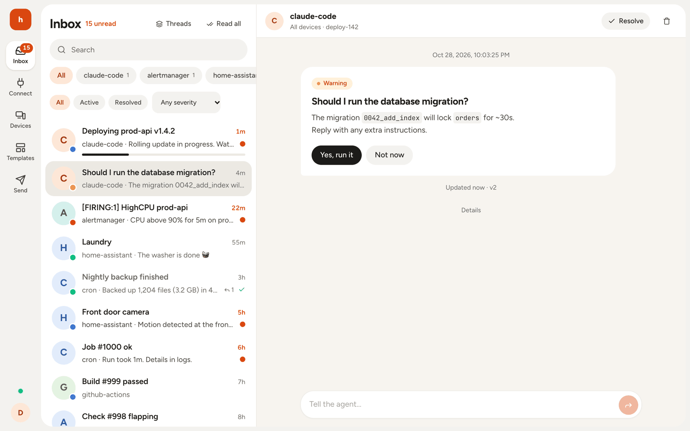
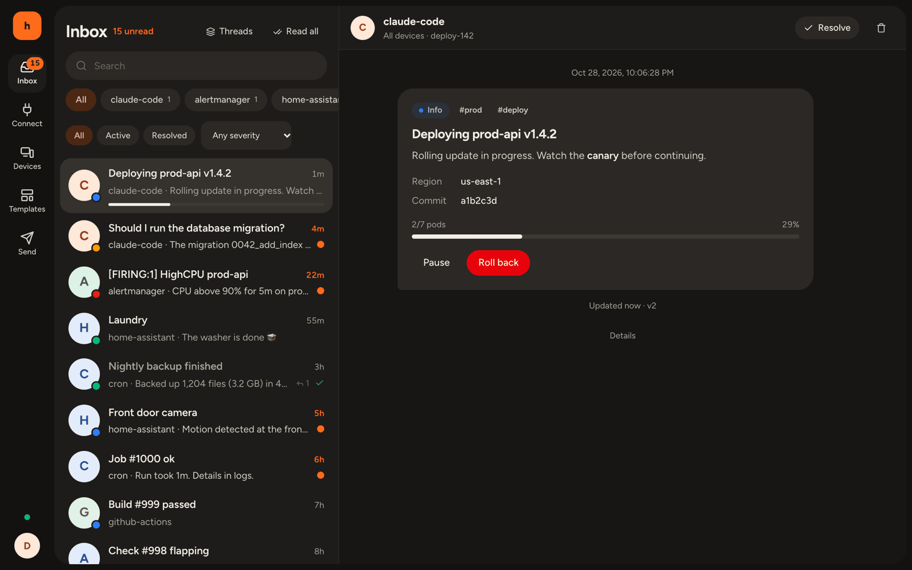
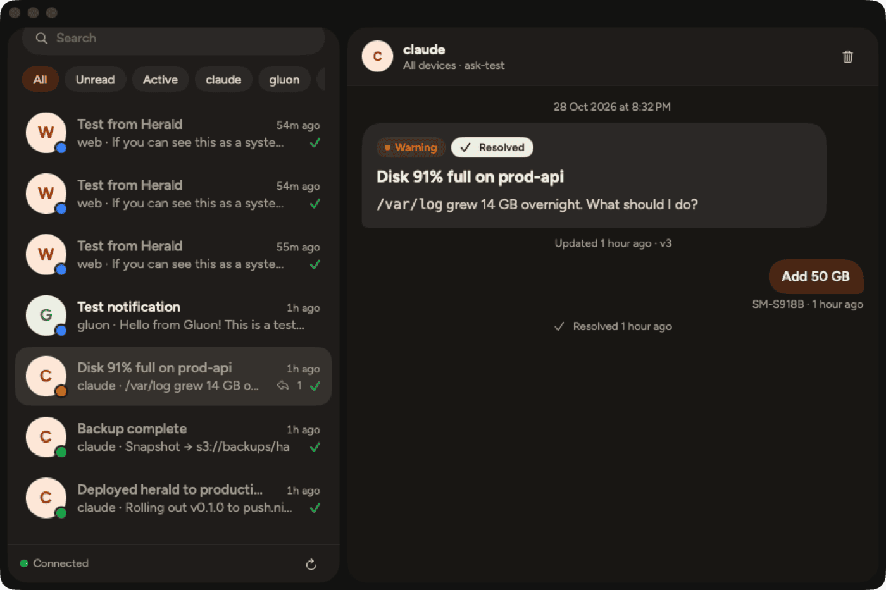
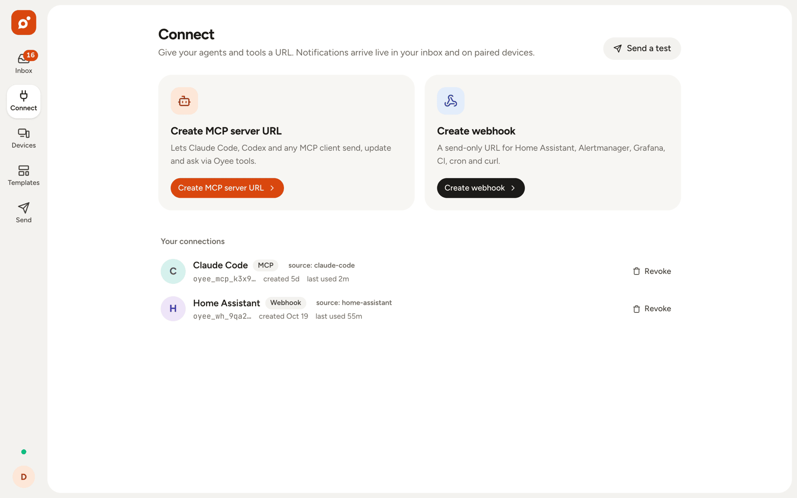
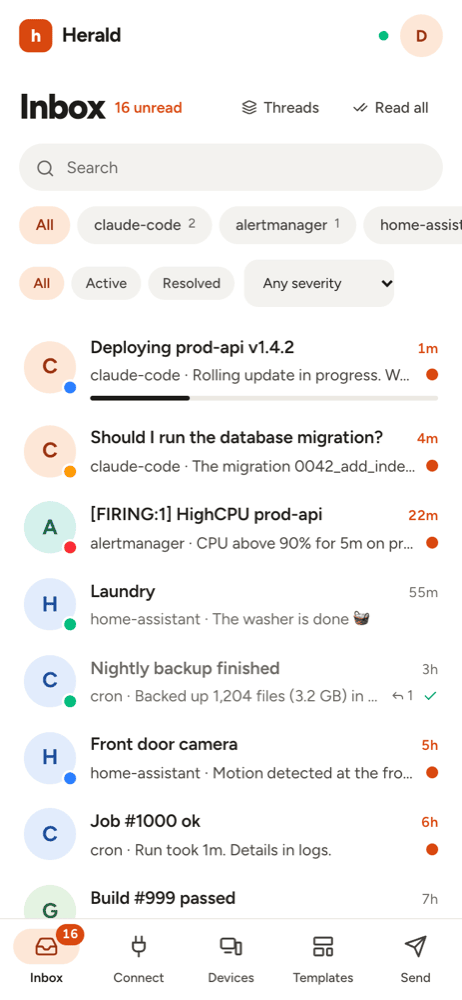

# Oyee

**One inbox for AI agents, scripts and webhooks.** Send a notification with one HTTP call or one MCP tool call, and
receive it on Android, macOS and the web, with live-updating progress, link and answer buttons, inline replies and sync
across devices.



- 🤖 **MCP server URL**: give Claude Code, Codex or any MCP client one tool per intent: `inform`, `ask`
  (+ `wait_for_response`) and `progress`. Target one device (`devices: ["macbook"]`) or all of them.
- 🪝 **Webhooks**: paste a URL into Home Assistant, Alertmanager, Grafana, AWS SNS, GitHub Actions, cron or curl.
- 🔄 **Live notifications** that update in place (progress, status), resolve everywhere, and record your answers.
- 💬 **Two-way**: agents ask, you tap a button or type a reply on any device, and the agent gets the answer.
- 🧩 **Three intents**: inform, ask and progress, each drawn natively on every platform. Every severity alerts.

Free and open source (MIT).

## Screenshots

| Web (dark) | macOS |
|---|---|
|  |  |

| Connect an agent or webhook | Android | Web on a phone |
|---|---|---|
|  |  |  |

## Download

| Platform | Get it |
|---|---|
| **Web** | <https://oyee.app>: sign in with Google, nothing to install |
| **Android** (8.0+) | `Oyee-x.y.z.apk` from [Releases](../../releases/latest). Allow *Install unknown apps* when asked |
| **macOS** (14+, Apple Silicon and Intel) | `Oyee-x.y.z-macOS.zip` from [Releases](../../releases/latest). Not notarized: if macOS blocks the first launch, open **System Settings → Privacy & Security → Open Anyway** (or run `xattr -cr /Applications/Oyee.app`) |
| **iOS** | Build from source ([docs/setup.md](docs/setup.md)). iOS can't be distributed without a paid Apple account |

Or let a coding agent on your computer do it: see [Install with an AI agent](#install-with-an-ai-agent).

Then pair the device: on the web, **Home → Connect a device**, and enter the code in the app.

**Updates:** the macOS app updates itself from GitHub Releases in the background (download, checksum check, restart;
can be turned off in Settings). The Android app notifies you about a new release; **Update** downloads the APK with
Android's download manager, and you tap the "Download complete" notification to install. (The app doesn't install
APKs itself: Play Protect blocks sideloaded apps that can.) Releases are built and signed by GitHub Actions ([release.yml](.github/workflows/release.yml)); each one includes `SHA256SUMS.txt`.

### Install with an AI agent

A coding agent running on your computer (Claude Code, Codex…) can do the install for you: paste one of these prompts.
The same prompts are on <https://oyee.app> below the downloads, and in the web app under **Help**.

**macOS**, from an agent on your Mac:

```text
Install the Oyee macOS app on this Mac from its latest GitHub release (https://github.com/Nishkalkashyap/oyee/releases/latest):
1. Find the Oyee-<version>-macOS.zip and SHA256SUMS.txt assets via https://api.github.com/repos/Nishkalkashyap/oyee/releases/latest and download both to a new temporary directory.
2. Check the zip's SHA-256 against SHA256SUMS.txt. Stop and tell me if it doesn't match.
3. Unzip it, quit Oyee if it's running, and move Oyee.app to /Applications, replacing any older copy.
4. The app is ad-hoc signed and not notarized, so clear its download flags so Gatekeeper doesn't block it: xattr -cr /Applications/Oyee.app
5. Open it with: open /Applications/Oyee.app (it lives in the menu bar).
Then tell me to pair it: on https://oyee.app go to Home → Connect a device and enter the code in the app.
```

**Android**, from an agent on a computer with `adb`, with your phone plugged in and USB debugging on:

```text
Install the Oyee Android app on my phone over USB from its latest GitHub release (https://github.com/Nishkalkashyap/oyee/releases/latest):
1. Check that adb is installed and that adb devices lists exactly one authorized phone. If not, explain how to turn on USB debugging and stop.
2. Find the Oyee-<version>.apk and SHA256SUMS.txt assets via https://api.github.com/repos/Nishkalkashyap/oyee/releases/latest and download both to a new temporary directory.
3. Check the APK's SHA-256 against SHA256SUMS.txt. Stop and tell me if it doesn't match.
4. Install it with: adb install -r <apk>. If that fails with INSTALL_FAILED_UPDATE_INCOMPATIBLE, a build signed with a different key is installed: ask me before uninstalling it (that deletes its data).
5. Start it with: adb shell monkey -p app.oyee.android 1
Then tell me to pair it: on https://oyee.app go to Home → Connect a device and enter the code in the app.
```

## Quick start

1. Sign in at <https://oyee.app> (or [run your own instance](docs/setup.md)).
2. On **Connect**, create an MCP server URL for your agent or a webhook for everything else.
3. Send something:

```bash
# Webhook
curl -d "Backup finished" "https://oyee.app/hook/<webhook-token>?title=Backup&severity=success"

# Claude Code
claude mcp add --transport http oyee https://oyee.app/mcp/<mcp-token>
```

## Docs

| | |
|---|---|
| [docs/setup.md](docs/setup.md) | Run your own instance: Cloudflare, Google sign-in, Firebase, web, Android, macOS |
| [docs/protocol.md](docs/protocol.md) | The API contract: REST, WebSocket, webhooks, MCP tools, push payloads |
| [docs/design.md](docs/design.md) | Design language (shared by web, macOS and Android) |
| [docs/operations.md](docs/operations.md) | Maintainer runbook: deploys, releases, secrets, rollback, gotchas |
| [AGENTS.md](AGENTS.md) | Start here if you're an AI agent or new maintainer: map, rules, commands |
| [PLAN.md](PLAN.md) | Product plan, decisions and status |

## Repository

| Path | What |
|---|---|
| `packages/schema` | Shared TypeScript types + zod schemas (protocol source of truth) |
| `apps/server` | Cloudflare Worker: API, MCP, webhooks, Durable Objects, D1 (Drizzle), push fan-out |
| `apps/web` | React web app (served by the worker) |
| `apps/android` | Android app (Kotlin, Compose) |
| `apps/apple` | macOS menu-bar app + iOS app (SwiftUI) + OyeeKit |

## Develop

```bash
pnpm install
pnpm dev          # wrangler dev + vite
pnpm test
pnpm android:build
pnpm macos:build
```

**Releasing:** `git tag vX.Y.Z && git push origin vX.Y.Z` builds the signed APK and the universal macOS app and
publishes them on GitHub Releases. Checklist: [docs/operations.md §3](docs/operations.md#3-publish-an-app-release-android--macos).
